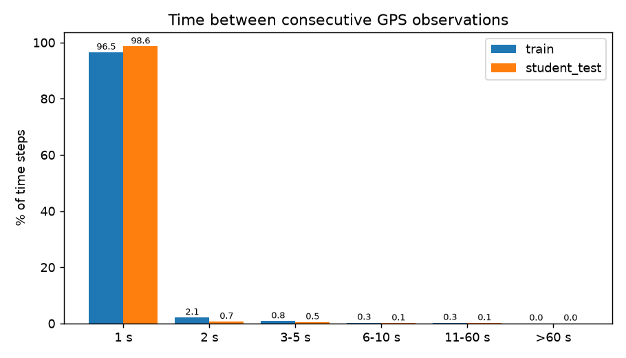
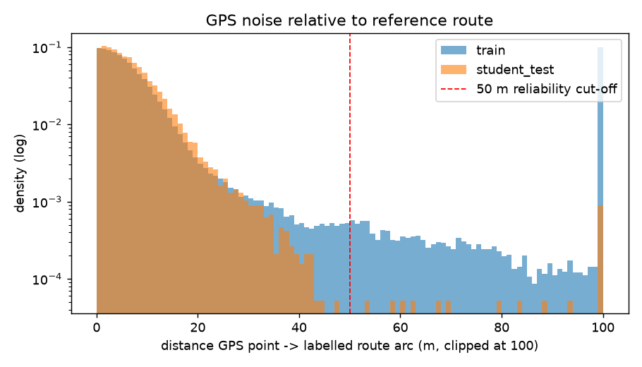
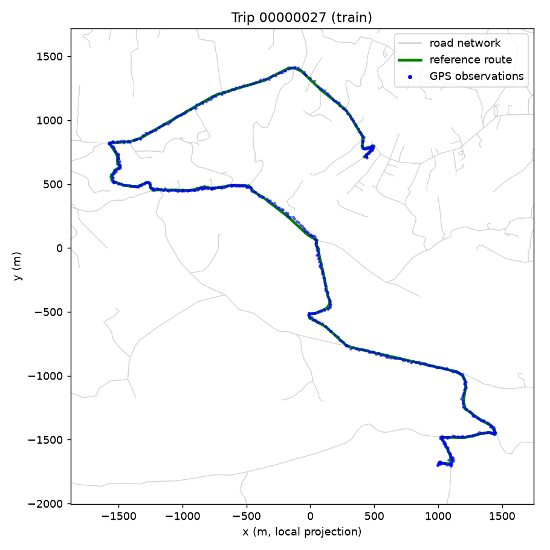
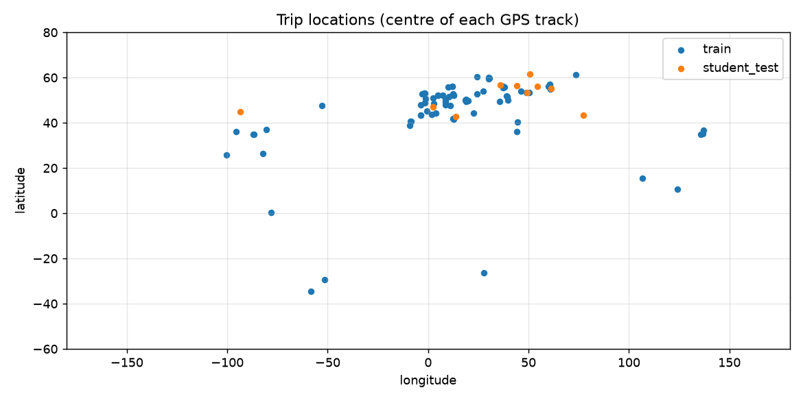
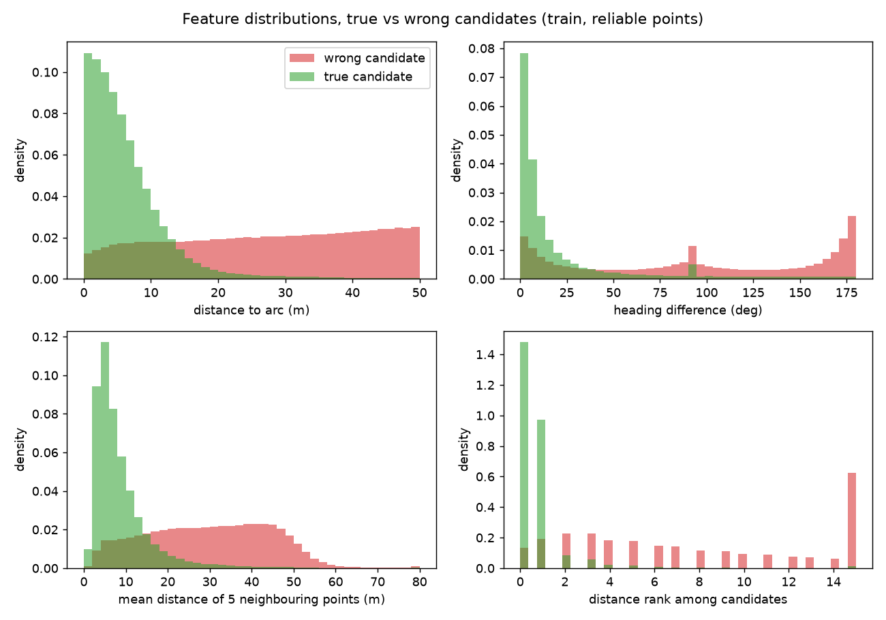
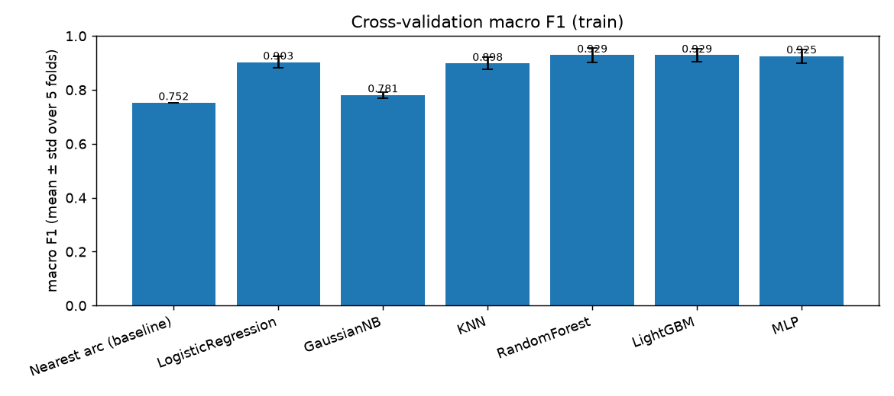
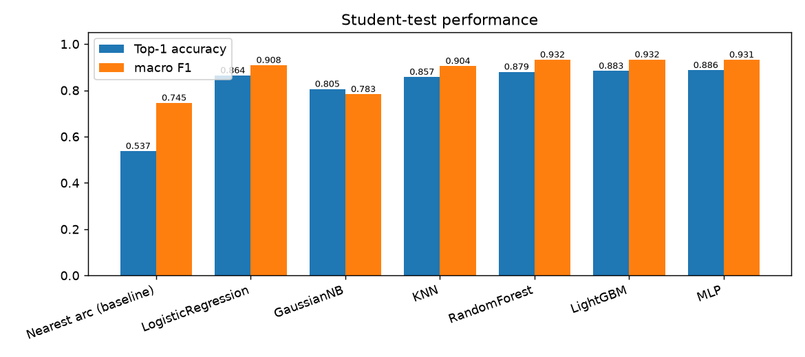
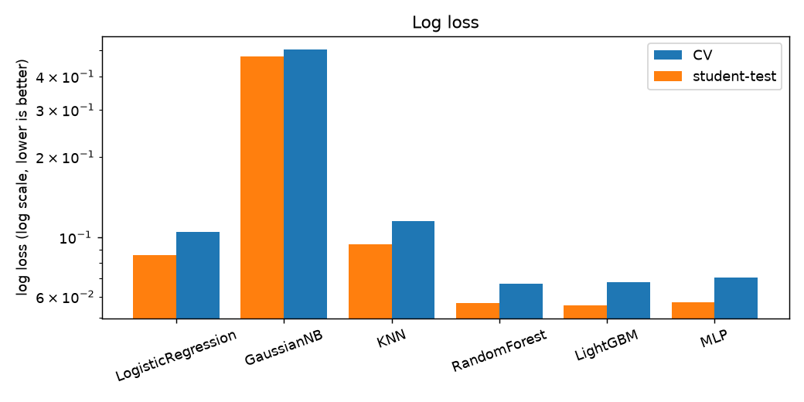
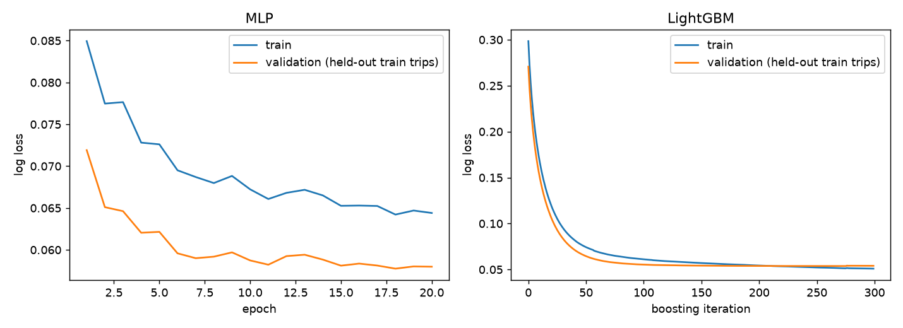
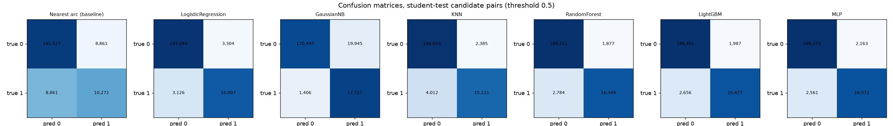

# PathSnap - Map-matching and Route Reconstruction

Matches noisy GPS trajectories to a road network. For every GPS point a
classifier (LightGBM) scores the nearby road
segments; an HMM/Viterbi decoder then turns those scores into a connected
route. A FastAPI backend (laptop 1) serves predictions to a browser UI
(laptop 2).

```
GPS track + road network
   -> candidates (arcs within 50 m)  -> 13 features per (point, arc)
   -> classifier probability          -> HMM / Viterbi  -> one arc per GPS point
```

## Results so far (Stages 1-4)

All numbers below come from the files in `results/` and can be reproduced with
the commands in section 3. Partitions: models are trained on `train`
(80 trips) and compared on `student_test` (10 trips).

### Dataset (EDA)
| | train | student_test |
|---|---|---|
| trips | 80 | 10 |
| GPS observations | 208,417 | 19,160 |
| missing values / invalid coordinates | 0 / 0 | 0 / 0 |
| time steps exactly 1 s apart | 96.5% | 98.6% |
| median nodes / arcs per trip | 9,608 / 19,526 | 6,597 / 13,145 |
| median GPS-to-route distance | 4.63 m | 4.74 m |
| points with unreliable label (> 50 m from route) | 11.16% | 0.14% |

Unreliable labels come almost entirely from trips 54, 33 and 2, where the
reference route ends before the GPS track; those points are excluded from
training and scoring.

| Sampling intervals | GPS noise vs reference route |
|---|---|
|  |  |

| Example trip (network, route, GPS) | Trip locations |
|---|---|
|  |  |

Interactive Folium map: [`maps/eda_trip_00000027.html`](maps/eda_trip_00000027.html)
(download and open in a browser).

### Candidates and features
- Candidate arcs = all arcs within **50 m** of a GPS point (radius chosen on
  train: 0% miss rate on reliable points, ~9 candidates per point).
- 13 features per (point, candidate), e.g. distance, heading difference,
  distance of the 5 neighbouring GPS points to the arc.



### Model comparison
5-fold GroupKFold by trip on train (CV), then the final model is evaluated
on student_test. Top-1 accuracy = share of GPS points whose highest-scored
candidate is the reference arc.

| Model | Family | CV macro F1 (mean ± std) | CV Top-1 | Test macro F1 | Test Top-1 | Test log loss | Fit time (s) |
|---|---|---|---|---|---|---|---|
| Nearest arc (baseline) | Rule | 0.752 | 0.555 | 0.745 | 0.537 | n/a | 0 |
| Logistic Regression | Linear | 0.903 ± 0.021 | 0.865 | 0.908 | 0.864 | 0.086 | 1.1 |
| Gaussian Naive Bayes | Probabilistic | 0.781 ± 0.011 | 0.815 | 0.783 | 0.805 | 0.476 | 0.1 |
| KNN (k=25) | Instance-based | 0.898 ± 0.023 | 0.850 | 0.904 | 0.857 | 0.094 | 0.2 |
| Random Forest | Bagging | 0.929 ± 0.026 | 0.876 | 0.932 | 0.879 | 0.057 | 24.7 |
| **LightGBM** | Boosting | **0.929 ± 0.025** | **0.876** | **0.932** | 0.883 | **0.056** | 5.5 |
| MLP (64-32) | Neural network | 0.925 ± 0.026 | 0.876 | 0.931 | 0.886 | 0.057 | 28.9 |

**Selected model: LightGBM** - tied-best CV score, best student-test macro F1
and log loss (good probabilities for the HMM), and 5x faster to train than
Random Forest and the MLP. The nearest-arc baseline is weak because a
two-way street is two arcs at the same distance; the models use the heading
to tell the directions apart.

| CV macro F1 | Student-test Top-1 and macro F1 |
|---|---|
|  |  |

| Log loss | Training curves (MLP, LightGBM) |
|---|---|
|  |  |



Full table: [`results/models/model_comparison.csv`](results/models/model_comparison.csv) ·
all hyperparameters and seeds: [`results/models/experiment_log.json`](results/models/experiment_log.json) ·
explanations: [`VIVA_NOTES.md`](VIVA_NOTES.md).

*Still to come: Bayesian tuning of LightGBM, HMM/Viterbi route
reconstruction, API and UI results.*

## 1. Setup (both laptops)
```bash
git clone https://github.com/harshith2426/pathsnap.git
cd pathsnap
```
Laptop 1 only:
```bash
pip install -r requirements.txt
```
Laptop 2 only needs a browser and Python (for a static file server).

The raw dataset is **not** in the repo. By default the code expects it next to
the repo at `../Student folder/Student folder/` (with `train/` and
`student_test/`). Override with `PATHSNAP_DATA`.

## 2. Demo: two laptops
Both laptops on the same network (a phone hotspot works best).

**Laptop 1 - API**
```bash
# folder with the evaluation trips: <dir>/<trip_id>/<trip_id>.track|.nodes|.arcs|.route
set PATHSNAP_EVAL_DIR=D:\path\to\evaluation_trips        # Windows cmd
uvicorn api.main:app --host 0.0.0.0 --port 8000
```
Without `PATHSNAP_EVAL_DIR` the API serves the 10 student-test trips.
Find laptop 1's address with `ipconfig` (IPv4, e.g. 192.168.43.12) and allow
port 8000 in Windows Firewall if asked. The request log appears in this window.

**Laptop 2 - UI**
```bash
python -m http.server 8080 --directory ui
```
Open http://localhost:8080, type `http://<laptop-1-ip>:8000` in the API box,
press **Connect**, then click a trip. (Or edit `ui/config.js` once.)

Single-laptop test: run both commands on one machine and keep
`http://localhost:8000`.

## 3. Reproduce the experiments (laptop 1, repo root)
| Stage | Command | Output |
|---|---|---|
| Per-point labels | `python -m src.labels` | `data_derived/labels_*.csv` |
| EDA | `python -m src.eda` | `results/eda/` |
| EDA Folium maps | `python -m src.maps` | `maps/eda_trip_*.html` |
| Candidate radius study | `python -m src.candidates` | `results/candidates/radius_study_train.csv` |
| Candidates + features | `python -m src.features` | `data_derived/cands_*.pkl` |
| Feature plots | `python -m src.feature_eda` | `results/candidates/` |
| Baseline + 6 models | `python -m src.train_models` | `results/models/` |
| Bayesian tuning (Optuna) | `python -m src.tune` | `results/tuning/`, `artifacts/classifier.joblib` |
| HMM / Viterbi | `python -m src.run_hmm` | `results/hmm/`, `artifacts/hmm_config.json`, `maps/hmm_trip_*.html` |

Data rules: models are fitted on `train` only; `student_test` is used only for
comparison; the evaluator trips are only ever read by the running API.

## 4. Repository layout
```
src/          data loading, geometry, labels, EDA, candidates, features,
              models, metrics, tuning, HMM, prediction pipeline
api/          FastAPI backend (api/main.py)
ui/           evaluator interface (static HTML/JS + Leaflet)
artifacts/    final classifier, its config, HMM config
results/      CSV results, experiment logs and plots per stage
maps/         interactive Folium maps
VIVA_NOTES.md stage-by-stage explanation, results and viva questions
```
